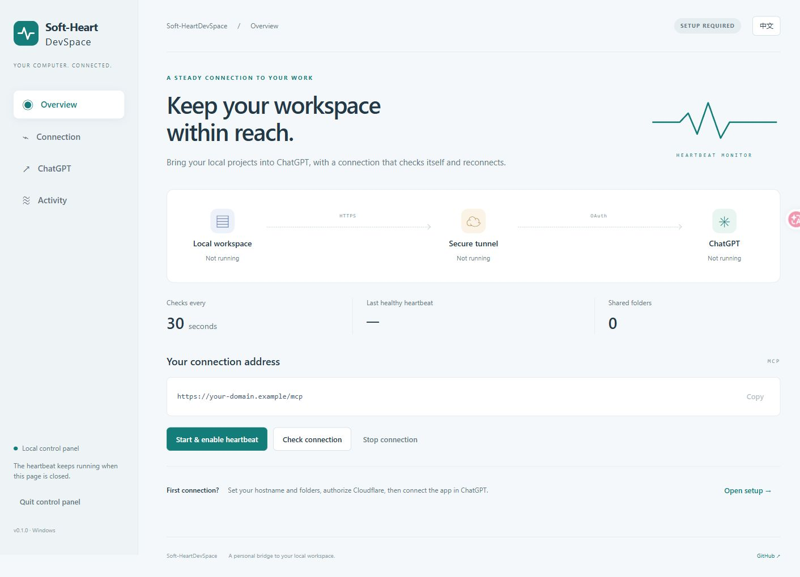

<div align="center">
  
  <h1>Soft-HeartDevSpace</h1>
  <p><strong>Your computer. Your domain. A connection that recovers.</strong></p>
  <p><strong>English</strong> · <a href="README.zh-CN.md">简体中文</a></p>
  <p>
    <a href="https://github.com/thekingofall/Soft-HeartDevSpace/releases/latest"></a>
    <a href="LICENSE"></a>
    
    <a href="https://github.com/thekingofall/Soft-HeartDevSpace/actions/workflows/test.yml"></a>
  </p>
</div>

**Soft-HeartDevSpace connects your Windows projects to ChatGPT through a domain you control.** Its local control panel brings folder selection, Cloudflare Tunnel setup, OAuth connection instructions, and automatic recovery into one place.

Use it to let ChatGPT inspect a codebase, edit project files, or run development commands on your computer. A background heartbeat checks the local service, tunnel, and public address, then restarts a failed component when its recovery conditions are met.


<div align="center">
  <a href="https://github.com/thekingofall/Soft-HeartDevSpace/releases/latest"><strong>Download Windows app</strong></a> ·
  <a href="#get-connected">Get connected</a> ·
  <a href="#when-a-connection-drops">Recovery</a> ·
  <a href="docs/DEVELOPMENT.md">Build from source</a>
</div>

## A control panel for your connection

| What you need | What the app provides |
| :--- | :--- |
| A stable address for ChatGPT | Your own HTTPS hostname with an MCP endpoint |
| A clear setup process | Domain, project folders, tool detection, and tunnel creation |
| Recovery after a process exits | Regular checks and bounded automatic restarts |
| A quiet Windows session | Hidden background workers and startup at user sign-in |
| A way to see what happened | Current health, last healthy heartbeat, and recovery logs |
| A choice of language | English and Simplified Chinese in the app and documentation |



## Before you begin

You need **Windows 10/11 x64**, **Node.js 24 LTS**, **Git for Windows**, **cloudflared**, and a domain whose DNS is managed by your Cloudflare account. Your ChatGPT account or workspace must allow custom MCP connections.

Install the prerequisites from [Node.js](https://nodejs.org/en/download), [Git for Windows](https://git-scm.com/downloads/win), and [Cloudflare's downloads](https://developers.cloudflare.com/tunnel/downloads/). Keep Node on the **24.x** line for this release. Soft-HeartDevSpace installs its supported DevSpace engine from npm when you choose **Install DevSpace 1.0.8**.

The Windows ZIP includes the control panel and its Python runtime. Node.js, Git, cloudflared, a domain, and a ChatGPT subscription or entitlement are separate. Soft-HeartDevSpace has no subscription fee; third-party services follow their own terms and pricing.

## Get connected

### 1. Open the Windows app

Download `Soft-HeartDevSpace-0.1.0-windows-x64.zip` from [Releases](https://github.com/thekingofall/Soft-HeartDevSpace/releases/latest), extract the **entire folder**, and run `Soft-HeartDevSpace.exe`. Keep the adjacent `_internal` folder. The app opens a private control panel in your default browser.

Use the **中文 / English** button to change language. Open **Connection** and choose **Detect tools**. Install the DevSpace engine if it is missing or incompatible. Advanced settings let you select executable paths when automatic detection cannot find a tool.

### 2. Set your hostname and folders

Enter a hostname such as `dev.example.com`, a tunnel name for this computer, and one existing project folder per line. Save the settings. Folder roots such as `D:\` can be entered when you intend to make an entire drive available.

Choose **Sign in to Cloudflare**, complete the browser login, and select the matching DNS zone. Then choose **Create connection**. The app creates or reuses the named local tunnel and adds the DNS route. An existing conflicting DNS record produces an error; review that record in Cloudflare or choose an unused hostname.

Choose **Start & enable heartbeat** on Overview. Allow up to three minutes for the first service startup. The panel reports each part of the connection separately. A reachable endpoint is ready for the next step; ChatGPT authorization is completed in ChatGPT.

### 3. Connect in ChatGPT

Open [ChatGPT Plugins](https://chatgpt.com/plugins) and find **Add custom MCP server** under the plus button. Some accounts show this under Apps, Plugins, or developer settings. Availability depends on your account and workspace policy; follow the [official connection guide](https://developers.openai.com/plugins/deploy/connect-chatgpt) for the current interface.

| Field | Value |
| :--- | :--- |
| Name | `My DevSpace` |
| Server URL | The address copied from Overview, e.g. `https://dev.example.com/mcp` |
| Authentication | `OAuth` |

Complete the creation and connection prompts. On your own domain's **Connect DevSpace** page, enter the **Owner password** available in this app's ChatGPT tab and approve the connection. The password is displayed on request and hidden again after 30 seconds.

Start a new chat, type `@`, select your connection, and try:

```text
Use my DevSpace connection to open C:\Projects\MyProject.
List its top-level files and folders, keeping file contents unchanged.
```

Replace the example path with a folder you configured. After the listing succeeds, you can request edits or development commands appropriate to that project.

## When a connection drops

The heartbeat runs on a **nominal 30-second schedule** through Windows Task Scheduler. Each check inspects DevSpace's `/healthz`, cloudflared's `/ready`, and the public `/healthz` address. Slow checks or Windows scheduling can delay a tick.

| Situation | Recovery behavior |
| :--- | :--- |
| A managed process disappears | Start it again, subject to a 60-second retry cooldown |
| A process is still starting | Allow a 180-second startup grace period |
| A running component repeatedly fails | Restart after 3 failed checks and a 5-minute recovery cooldown |
| Local service and tunnel look healthy, but the public address fails | After 5 failures, restart the tunnel for timeout / 502 / 503 / 504 / 530 responses, subject to a 15-minute cooldown |
| Duplicate matching processes are found | Record the conflict and defer recovery |
| You sign back into Windows | Run the hidden startup task after a short delay |

Closing the browser panel leaves an enabled heartbeat running. **Stop connection** pauses recovery and stops the app's managed processes. **Activity → Remove startup** also removes its scheduled task. Settings and OAuth state remain available for a later start.

The computer needs power, network access, and a signed-in Windows session. Sleep, shutdown, an unavailable network, expired/revoked OAuth access, DNS changes, and ChatGPT-side restrictions can require time or user action. The app does not perform campus-network login or change network authentication settings.

## Access and local data

The DevSpace engine exposes file and command tools. Commands run with the **current Windows user's permissions**. Configured project roots guide workspace access; command execution is **not an operating-system sandbox**. Use a dedicated Windows account or a separate machine when stronger isolation is required.

The control panel listens on `127.0.0.1` with a private session, origin checks, and request authentication. The tunnel exposes the DevSpace service, whose MCP access uses OAuth. Cloudflare carries the tunnel traffic, and data returned to ChatGPT is handled under the applicable service policies.

Local configuration, the Owner password, OAuth state, and logs live in `%LOCALAPPDATA%\Soft-HeartDevSpace`. Cloudflare account and tunnel credentials remain in the location managed by cloudflared, normally `%USERPROFILE%\.cloudflared`. Treat these folders as private. The public repository and release contain generic application files.

To remove the software, remove its startup task in Activity, quit the control panel, and delete the extracted app folder. You can retain the local settings for reinstalling. Delete the local data folder and revoke the connection in ChatGPT if you want to retire its authorization. Remove the tunnel and DNS record separately in Cloudflare when no longer needed.

## Troubleshooting

| What you see | What to check |
| :--- | :--- |
| Missing runtime tool | Install the prerequisite, reopen the app, and use Detect tools or the advanced path fields |
| Port already in use | Stop the other installation or choose unused service and metrics ports |
| Domain creation fails | Cloudflare zone ownership, tunnel credentials, and existing DNS records |
| Local service is healthy, public address fails | DNS route, cloudflared connectivity, proxy/network availability, and Cloudflare events |
| HTTP 403 or a Cloudflare error page | Inspect the matching Cloudflare security event and the applicable hostname rule |
| MCP returns 401 before login | Complete OAuth; an unauthenticated MCP response does not establish whether an authorized connection works |
| ChatGPT has no tools | Verify authorization, refresh the connection's tool metadata, then try a new chat with the connection selected |
| Nothing happens after restarting Windows | Sign in to Windows and confirm the `Soft-HeartDevSpace-…` scheduled task is enabled |

Use **Activity** for recent heartbeat records. The local `logs` folder also contains DevSpace and cloudflared output for diagnosing startup problems. Remove private paths, hostnames, and credentials before sharing logs.

## Project and compatibility

Soft-HeartDevSpace is an independent Windows companion to [Waishnav/DevSpace](https://github.com/Waishnav/DevSpace) and [Cloudflare Tunnel](https://developers.cloudflare.com/tunnel/). Version **0.1.0** targets **DevSpace 1.0.8 + Node.js 24**. Engine upgrades require compatibility testing, because configuration and tool behavior can change.

The overview illustration follows the clear panels and restrained palette of the author's [scFetallife_Blood](https://github.com/thekingofall/scFetallife_Blood) project. It is newly drawn for this software; its editable [R source](scripts/draw_overview.R) and [vector PDF](docs/images/connection-overview.pdf) are included.

[Development and verification](docs/DEVELOPMENT.md) · [Privacy and security](docs/SECURITY.md) · [Third-party notices](NOTICE) · [MIT license](LICENSE)
