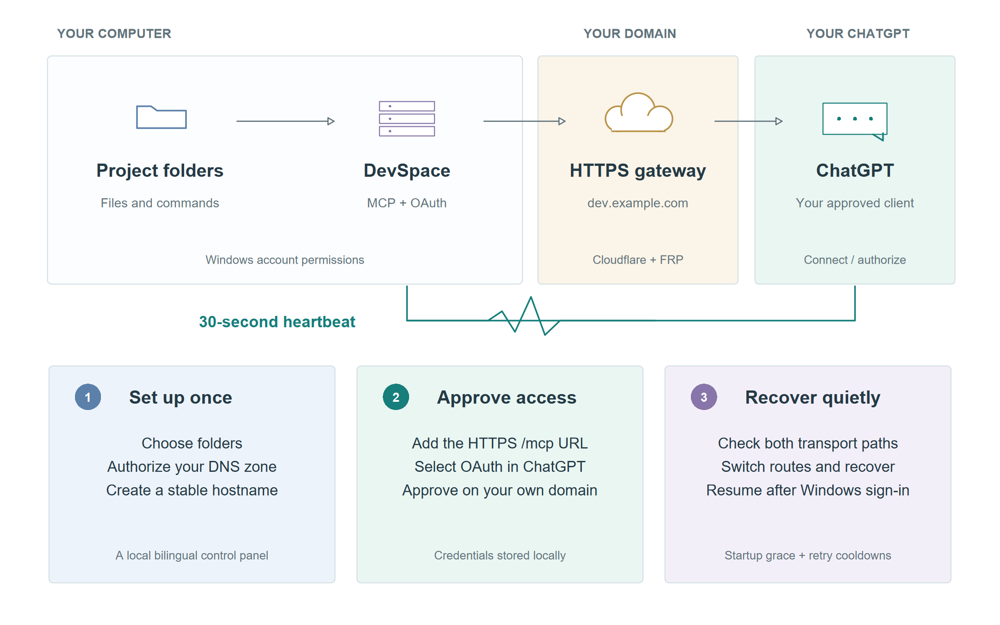
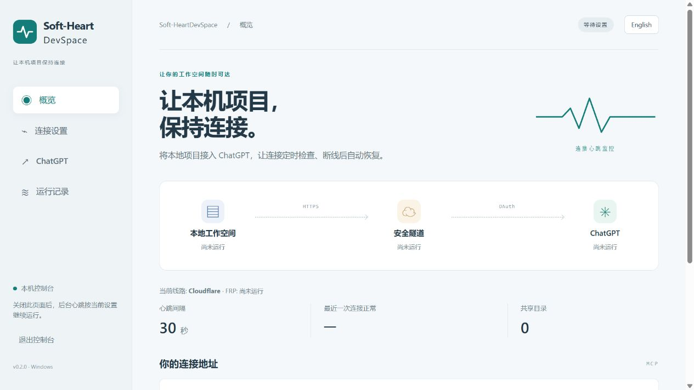

<div align="center">
  
  <h1>Soft-HeartDevSpace</h1>
  <p><strong>连接你的电脑与 ChatGPT，让本地工作空间保持可达。</strong></p>
  <p><a href="README.md">English</a> · <strong>简体中文</strong></p>
  <p>
    <a href="https://github.com/thekingofall/Soft-HeartDevSpace/releases/latest"></a>
    <a href="LICENSE"></a>
    
    <a href="https://github.com/thekingofall/Soft-HeartDevSpace/actions/workflows/test.yml"></a>
  </p>
</div>

**Soft-HeartDevSpace 是一款 Windows 本地连接管理软件，让网页版 ChatGPT 通过你的域名访问电脑上的项目。** 域名设置、目录选择、Cloudflare 隧道、OAuth 授权指引和断线恢复，集中在一个中英文控制台中。

连接后，你可以让 ChatGPT 阅读代码、修改项目文件、运行开发命令。后台心跳会定期检查本地服务、隧道和公网地址；满足恢复条件时，自动重新启动发生故障的组件。



<div align="center">
  <a href="https://github.com/thekingofall/Soft-HeartDevSpace/releases/latest"><strong>下载 Windows 软件</strong></a> ·
  <a href="#开始连接">开始连接</a> ·
  <a href="#断线后如何恢复">自动恢复</a> ·
  <a href="docs/DEVELOPMENT.md">源码与构建</a>
</div>

## 它能帮你完成什么

| 使用需求 | 软件功能 |
| :--- | :--- |
| 为 ChatGPT 提供固定连接地址 | 使用你自己的 HTTPS 域名和 MCP 地址 |
| 整理繁琐的首次配置 | 设置域名、选择目录、检测工具、创建隧道 |
| 服务异常退出后重新连接 | 定时检查，并按恢复策略重新启动组件 |
| 登录电脑后继续使用 | Windows 登录自启，后台隐藏运行 |
| 了解断线发生在哪一层 | 展示服务、隧道、公网状态和恢复记录 |
| 中英文使用体验 | 界面和 README 均支持中英文选择 |



## 使用前准备

**0.2.0 新增 FRP 与双通道模式。** 配合自有 HTTPS 中转网关，Cloudflare 和 FRP 可以共用一个 ChatGPT 地址，并在连续健康检查失败后自动切换。控制台会显示当前线路。[FRP 配置指南](docs/FRP.zh-CN.md)包含服务器模板、证书、DNS 和恢复策略。下方继续介绍 Cloudflare 模式的首次配置。

需要 **Windows 10/11 x64**、**Node.js 24 LTS**、**Git for Windows**、**cloudflared**，以及一个由 Cloudflare 管理 DNS 的域名。ChatGPT 账户或工作区需要允许使用自定义 MCP 连接。

从 [Node.js 官网](https://nodejs.org/en/download)、[Git for Windows](https://git-scm.com/downloads/win) 和 [Cloudflare 下载页](https://developers.cloudflare.com/tunnel/downloads/)安装运行工具。本版本使用 **Node.js 24.x**。控制台中的“安装 DevSpace 1.0.8”会从 npm 安装已适配的引擎版本。

Windows 下载包包含控制台及其 Python 运行环境。Node.js、Git、cloudflared、域名和 ChatGPT 的使用资格需要单独准备。Soft-HeartDevSpace 本身免费开源，第三方服务按各自规则提供服务和计费。

## 开始连接

### 1. 打开软件

在 [Releases](https://github.com/thekingofall/Soft-HeartDevSpace/releases/latest) 下载 `Soft-HeartDevSpace-0.2.0-windows-x64.zip`，**完整解压文件夹**，双击 `Soft-HeartDevSpace.exe`。请保留同目录中的 `_internal` 文件夹。软件会在默认浏览器中打开本机控制台。

右上角可以切换“中文 / English”。进入“连接设置”，点击“检测运行工具”；需要时点击“安装 DevSpace 1.0.8”。自动检测未找到工具时，可以展开高级设置，填写对应程序的完整路径。

### 2. 设置域名和项目目录

填写 `dev.example.com` 这样的子域名，为这台电脑的隧道取名，并逐行填写已存在的项目目录，然后保存。需要开放整盘时，可以填写 `D:\` 这样的盘符根目录。

点击“登录 Cloudflare”，在浏览器完成登录并选择对应站点。回到控制台点击“创建连接”，软件会创建或复用指定名称的本地隧道，并建立 DNS 路由。域名已有冲突记录时会显示错误，请核对 Cloudflare 中的记录或换一个未使用的子域名。

回到概览，点击“启动并启用心跳”。首次启动最长预留三分钟。控制台会分别显示本地服务、隧道和公网地址的状态。地址可达后，继续在 ChatGPT 中完成授权。

### 3. 接入 ChatGPT 网页

打开 [ChatGPT 插件页面](https://chatgpt.com/plugins)，在加号菜单中找到“添加自定义 MCP 服务器”。部分账户的入口位于应用、插件或开发者设置中。具体开放情况取决于账户和工作区策略，菜单以 [OpenAI 官方接入说明](https://developers.openai.com/plugins/deploy/connect-chatgpt)为准。

| 字段 | 填写内容 |
| :--- | :--- |
| 名称 | `我的 DevSpace` |
| 服务器 URL | 复制概览中的地址，例如 `https://dev.example.com/mcp` |
| 身份验证 | `OAuth` |

按页面提示创建并连接。在跳转到你自己域名的 **Connect DevSpace** 授权页后，填写软件“ChatGPT”页中的 **Owner 密码**，批准连接。密码按需显示，30 秒后自动隐藏。

回到 ChatGPT，新建对话，输入 `@` 并选择该连接，先试一条指令：

```text
请使用我的 DevSpace 连接，打开 C:\Projects\MyProject，
列出顶层文件和文件夹，保持文件内容不变。
```

将示例路径换成已配置的真实目录。目录列出成功后，就可以继续提出代码修改或开发命令的需求。

## 断线后如何恢复

后台通过 Windows 任务计划程序，按**约 30 秒一次**的频率检查 DevSpace 的 `/healthz`、cloudflared 的 `/ready` 和公网 `/healthz`。检查耗时与 Windows 调度可能使实际间隔变长。

| 发生的情况 | 恢复方式 |
| :--- | :--- |
| 受管理的进程退出 | 自动启动，连续启动之间保留 60 秒冷却期 |
| 服务刚开始启动 | 预留 180 秒启动时间 |
| 进程仍在运行，但连续检查异常 | 累计 3 次失败且距上次恢复已超过 5 分钟时重启 |
| 本地与隧道正常，公网地址持续异常 | 连续 5 次超时或 502 / 503 / 504 / 530 时重启隧道，两次恢复之间至少 15 分钟 |
| 发现重复的匹配进程 | 记录冲突，等待处理 |
| 重新登录 Windows | 稍作延迟后启动隐藏任务 |

关闭控制台标签页后，已启用的心跳继续运行。“停止连接”会暂停恢复并停止本软件管理的进程；“运行记录 → 移除自动启动”会进一步删除计划任务。配置和 OAuth 状态会保留，便于下次启动。

电脑需要保持开机、联网并已登录 Windows。休眠、关机、网络中断、授权过期或撤销、DNS 变化，以及 ChatGPT 端限制，仍可能需要等待或人工处理。本软件不执行校园网认证，也不会修改网络登录设置。

## 访问范围和数据位置

DevSpace 提供文件操作和命令执行工具。命令以**当前 Windows 用户的权限**运行。项目根目录用于限定工作空间的入口；命令执行仍受 Windows 账户权限约束，强隔离需求适合使用独立账户或独立电脑。

控制台监听 `127.0.0.1`，使用私有会话、来源校验和请求认证。Cloudflare 隧道对外提供 DevSpace 服务，MCP 访问通过 OAuth 授权。隧道流量由 Cloudflare 转发，返回 ChatGPT 的数据受相关服务政策约束。

软件配置、Owner 密码、OAuth 状态及日志保存在 `%LOCALAPPDATA%\Soft-HeartDevSpace`。Cloudflare 凭据由 cloudflared 管理，通常位于 `%USERPROFILE%\.cloudflared`。这些目录应当作为私人数据保管；公开仓库和下载包提供通用程序文件。

卸载时，先在运行记录中移除自启，退出控制台，再删除解压出的软件文件夹。可以保留本地配置以便重新安装；彻底停用时，在 ChatGPT 中撤销连接并删除本地数据目录。Cloudflare 的隧道和 DNS 记录可在确认不再使用后单独移除。

## 常见问题

| 页面表现 | 检查位置 |
| :--- | :--- |
| 缺少运行工具 | 安装依赖，重新打开软件并检测；或在高级设置填写路径 |
| 端口被占用 | 停止已有实例，或设置空闲的服务端口与健康检查端口 |
| 创建域名连接失败 | Cloudflare 站点权限、隧道凭据、已有 DNS 记录 |
| 本地正常，公网无法访问 | DNS 路由、隧道连接、代理或网络状态、Cloudflare 事件 |
| 出现 HTTP 403 或 Cloudflare 错误页 | 对照 Cloudflare 安全事件，检查该域名实际命中的规则 |
| 登录前访问 MCP 得到 401 | 继续完成 OAuth，随后验证已授权的工具调用 |
| ChatGPT 没有显示文件工具 | 检查授权，刷新连接工具信息，再新建对话并选中连接 |
| 重启电脑后没有连接 | 登录 Windows，检查 `Soft-HeartDevSpace-…` 计划任务是否启用 |

“运行记录”展示最近的心跳日志。本地 `logs` 目录还包含 DevSpace 和 cloudflared 输出，可用于排查启动问题。分享日志前，请清理私人路径、域名和凭据信息。

## 项目说明

Soft-HeartDevSpace 是基于 [Waishnav/DevSpace](https://github.com/Waishnav/DevSpace) 与 [Cloudflare Tunnel](https://developers.cloudflare.com/tunnel/) 的独立 Windows 连接管理软件。**0.2.0** 适配 **DevSpace 1.0.8 + Node.js 24**；引擎配置或工具行为发生变化时，需要重新验证兼容性。

说明图参考作者 [scFetallife_Blood 胎儿血项目](https://github.com/thekingofall/scFetallife_Blood)的分区布局与柔和配色，为软件连接流程重新绘制。仓库提供可编辑的 [R 绘图源文件](scripts/draw_overview.R)和[矢量 PDF](docs/images/connection-overview.pdf)。

[开发与验证](docs/DEVELOPMENT.md) · [隐私与安全](docs/SECURITY.md) · [第三方说明](NOTICE) · [MIT 开源协议](LICENSE)
