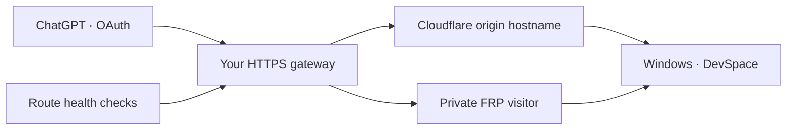

# FRP and dual transport

**English** · [简体中文](FRP.zh-CN.md) · [Home](../README.md)

FRP gives your computer a second route to its existing HTTPS address. ChatGPT keeps the same `/mcp` URL, and both routes reach the same DevSpace process and OAuth state.



## Choose a mode

| Mode | Windows components | Public entry |
| --- | --- | --- |
| Cloudflare | DevSpace + cloudflared | Cloudflare Tunnel |
| FRP | DevSpace + frpc | Your HTTPS relay, fixed FRP route |
| Dual | DevSpace + cloudflared + frpc | Your HTTPS relay, automatic route selection |

The relay is a Linux server you administer, with a public address, nginx, Python 3.9 or newer, systemd, and frps. Install matching frpc/frps versions; the integration reference is **FRP 0.58.0**. Download tools from [fatedier/frp](https://github.com/fatedier/frp/releases). The Windows ZIP includes configuration templates and the route checker; FRP and nginx are separate dependencies.

## 1. Prepare the private FRP route

Copy [`frpc-source.toml.example`](../relay/frpc-source.toml.example) to a private file on Windows. Set the server address, server token, a unique proxy name, and a randomly generated STCP key. Set `localPort` to the DevSpace port shown in the control panel. Keep one DevSpace STCP proxy per configuration file. `loginFailExit = false` lets frpc retry server login after network loss.

On the relay, adapt [`frpc-visitor.toml.example`](../relay/frpc-visitor.toml.example). Use the same proxy name and STCP key. The visitor listens on **127.0.0.1:17677**; this port remains private. Set credentials to mode `600` and their directory to `700`. Adapt the executable path in [`heartdevspace-visitor.service.example`](../relay/heartdevspace-visitor.service.example), install it as `heartdevspace-visitor.service`, and enable it with systemd. Reuse your existing frps installation without restarting unrelated tunnels.

TLS encryption is enabled in the templates. For verified server identity, configure `transport.tls.trustedCaFile` and `transport.tls.serverName` against your FRPS certificate authority. See the [FRP TLS guide](https://gofrp.org/en/docs/features/common/network/network-tls/). Keep server tokens, STCP keys, and certificate private keys outside Git and shared screenshots.

## 2. Prepare the HTTPS gateway

Use a public hostname such as `dev.example.com` and a separate Cloudflare origin hostname such as `cf-dev.example.com`. Create a publicly trusted certificate for the public hostname and arrange automatic renewal.

Adapt [`gateway.conf.example`](../relay/gateway.conf.example), then include it inside your nginx `http` block. Replace the example domains and certificate paths. Set the system CA bundle path for your Linux distribution. The example uses `/etc/pki/tls/certs/ca-bundle.crt`; Debian and Ubuntu commonly use `/etc/ssl/certs/ca-certificates.crt`.

The gateway reserves loopback port **17678** for its Cloudflare bridge. Confirm both loopback ports are free. Create `/etc/soft-heartdevspace/active-route.conf` with an initial healthy route:

```nginx
set $heart_backend http://127.0.0.1:17677;
set $heart_transport frp;
```

Run `nginx -t` using your actual nginx configuration path, then reload the corresponding service. Validate HTTPS, `/healthz`, OAuth discovery, and an unauthenticated `/mcp` request before changing DNS. A healthy endpoint returns `200`; MCP requires OAuth and returns `401` before authorization.

For dual mode, copy `failover.py` and an adapted `failover.json.example` into `/etc/soft-heartdevspace`. Set `validate_command` and `reload_command` to your nginx instance. Install the supplied `heartdevspace-route.service` and `.timer` files into `/etc/systemd/system`, run `systemctl daemon-reload`, and enable `heartdevspace-route.timer`. For FRP mode, keep the fixed FRP route and omit the route-selection timer.

Point the public hostname's **DNS-only A record** to the relay. Its Cloudflare origin alias stays proxied and points to the Cloudflare tunnel. This makes the FRP route independent of Cloudflare's proxy. Protect the relay with normal host security and keep its HTTPS and FRPS listener ports reachable.

## 3. Configure Windows

In **Connection**, select **FRP** or **Dual transport**. Enter the public HTTPS hostname. For dual mode, also enter the separate Cloudflare origin hostname. Enter the paths to `frpc.exe` and your private STCP `.toml` file, then save.

In dual mode, use **Create connection** in the Cloudflare section to create the origin alias. Start the heartbeat. The Overview shows local service, Cloudflare, FRP, public endpoint, and the active route reported by the gateway. Its dedicated FRP health endpoint is `/_heart/frp-health`.

Use the public hostname's `/mcp` URL in ChatGPT with OAuth. The gateway forwards authorization and streaming responses; the DevSpace public base URL remains the public hostname. Existing installations should retain their Owner password and OAuth state during migration.

## Recovery behavior

The relay probes both paths about every ten seconds. After two consecutive active-route failures, it switches when the other path is healthy. After Cloudflare returns, three successful checks and a minimum 60-second hold on FRP allow a return to Cloudflare. Probe and reload times affect the actual delay. If both paths fail, the current route stays selected and checks continue.

Windows checks managed processes on its nominal 30-second schedule. Missing processes restart subject to cooldowns; startup has a 180-second grace period. The windowless launcher creates services without a console, writes their output to logs, and cleans up their process tree when the managed service exits.

An in-flight request can fail during a network break. The gateway leaves MCP write retries to the client because repeating an uncertain command can repeat its side effects. The fixed relay remains a shared dependency: its outage, Windows shutdown, or loss of the computer's network affects both routes. Multi-relay redundancy requires a separate deployment design.

## Acceptance checks

Before switching public DNS, verify HTTPS from outside the relay and complete any domain registration required by the hosting region. Keep the working endpoint while the public gateway is pending. Advanced deployments can set `frp_health_pending: true` in a dedicated FRP heartbeat instance's `settings.json`. The worker still restarts an absent frpc process and reports public route verification as pending. Set the value to `false` after gateway acceptance to enable full route health checks.

Confirm both direct route health checks, trusted HTTPS, correct OAuth issuer, an authorized file read, automatic switching after a route failure, automatic return after recovery, and Windows recovery after terminating the dedicated frpc process. Keep existing applications on the relay healthy during these checks. Record certificate expiry and renewal status with the deployment's operations notes.
