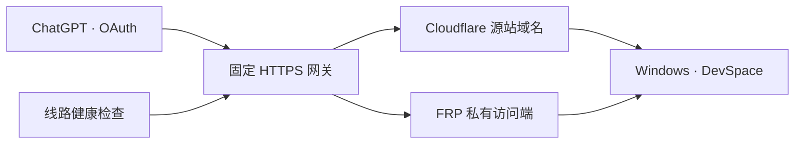

# FRP 与双通道连接

[English](FRP.md) · **简体中文** · [返回首页](../README.zh-CN.md)

FRP 为电脑提供第二条访问线路。ChatGPT 沿用原来的 HTTPS `/mcp` 地址，两条线路连接同一个 DevSpace 服务和同一份 OAuth 授权状态。



## 选择连接模式

| 模式 | Windows 运行组件 | 公网入口 |
| --- | --- | --- |
| Cloudflare | DevSpace、cloudflared | Cloudflare Tunnel |
| FRP | DevSpace、frpc | 自有 HTTPS 中转网关，固定走 FRP |
| 双通道 | DevSpace、cloudflared、frpc | 自有 HTTPS 中转网关，自动选择线路 |

中转服务器需要公网地址、nginx、Python 3.9 或更新版本、systemd 和 frps。frpc 与 frps 应使用匹配版本，本项目的集成参考版本为 **FRP 0.58.0**。运行程序从 [fatedier/frp 官方发布页](https://github.com/fatedier/frp/releases)获取。Windows 下载包内含配置模板和线路检查程序；FRP、nginx 需要单独安装。

## 1. 建立 FRP 私有线路

将 [`frpc-source.toml.example`](../relay/frpc-source.toml.example) 复制到 Windows 私人配置目录，填写服务器地址、服务器 token、唯一代理名称和随机生成的 STCP 密钥。`localPort` 对应控制台中的 DevSpace 端口。每个配置文件包含一个专用 DevSpace STCP 代理。`loginFailExit = false` 让 frpc 在网络恢复后继续尝试登录服务器。

中转端使用 [`frpc-visitor.toml.example`](../relay/frpc-visitor.toml.example)，代理名称和 STCP 密钥与 Windows 端一致。访问端监听 **127.0.0.1:17677**，保留为服务器内部端口。凭据文件权限设为 `600`，目录权限设为 `700`。修改 [`heartdevspace-visitor.service.example`](../relay/heartdevspace-visitor.service.example) 的程序路径后，保存为 `heartdevspace-visitor.service`，通过 systemd 启用。服务器已有 frps 时，可复用已有实例并保留其他项目的隧道。

模板启用了 TLS 加密。需要验证 FRPS 服务端身份时，请按服务器证书配置 `transport.tls.trustedCaFile` 与 `transport.tls.serverName`，参考 [FRP TLS 官方说明](https://gofrp.org/en/docs/features/common/network/network-tls/)。服务器 token、STCP 密钥和证书私钥应保存在私人配置目录。

## 2. 设置固定 HTTPS 网关

准备公网域名，例如 `dev.example.com`，以及单独的 Cloudflare 源站域名，例如 `cf-dev.example.com`。为公网域名配置受信任的 HTTPS 证书和自动续期。

修改 [`gateway.conf.example`](../relay/gateway.conf.example) 中的域名、证书路径及系统 CA 证书包路径，将文件包含在 nginx 的 `http` 块内。模板使用 `/etc/pki/tls/certs/ca-bundle.crt`；Debian、Ubuntu 常用 `/etc/ssl/certs/ca-certificates.crt`。

网关通过 **127.0.0.1:17678** 访问 Cloudflare 线路。先确认两个内部端口空闲，再创建 `/etc/soft-heartdevspace/active-route.conf`，选择已经验证健康的初始线路，例如：

```nginx
set $heart_backend http://127.0.0.1:17677;
set $heart_transport frp;
```

使用实际配置路径运行 `nginx -t`，通过后平滑重载对应服务。修改 DNS 前，应检查新网关的 HTTPS、`/healthz`、OAuth 发现信息和未登录的 `/mcp` 请求。健康地址返回 `200`，MCP 在 OAuth 授权前返回 `401`。

双通道模式下，将 `failover.py` 和修改后的 `failover.json.example` 放入 `/etc/soft-heartdevspace`。其中 `validate_command`、`reload_command` 要对应实际 nginx 实例。将提供的 `heartdevspace-route.service` 与 `.timer` 放入 `/etc/systemd/system`，执行 `systemctl daemon-reload` 并启用 `heartdevspace-route.timer`。FRP 模式使用固定 FRP 路由，线路选择定时器可省略。

公网域名使用指向中转服务器的 **A 记录，代理状态选择“仅 DNS”**；Cloudflare 源站别名继续使用代理并指向隧道。FRP 线路因此可独立于 Cloudflare 代理工作。中转服务器需保持 HTTPS 和 FRPS 监听端口可达，并执行常规系统安全维护。

## 3. 配置 Windows 软件

进入“连接设置”，选择“FRP”或“双通道”。公网域名填写固定 HTTPS 地址；双通道还需填写独立的 Cloudflare 源站域名。填写 `frpc.exe` 和私人 STCP `.toml` 文件的路径，保存设置。

双通道模式在 Cloudflare 区域点击“创建连接”建立源站别名，再启动心跳。概览会显示本地服务、Cloudflare、FRP、公网地址和网关当前采用的线路。FRP 的独立健康检查入口为 `/_heart/frp-health`。

ChatGPT 中填写公网域名的 `/mcp` 地址，身份验证选择 OAuth。网关转发授权与流式响应，DevSpace 的公网基础地址保持为该域名。迁移已有安装时，应保留 Owner 密码和 OAuth 状态文件。

## 掉线后的恢复方式

服务器约每十秒检查两条线路。当前线路连续两次异常、另一条健康时切换；Cloudflare 恢复后，需要连续三次成功，并满足在 FRP 上至少停留 60 秒的条件，才会回切。实际延迟受检查耗时及重载时间影响。两条线路均异常时，继续保留当前线路并检查恢复情况。

Windows 心跳按约 30 秒的周期检查进程，按冷却策略恢复已退出的组件，并预留 180 秒启动时间。静默启动器从创建时关闭控制台，输出写入日志；受管理服务退出时清理其子进程。

网络中断时，正在执行的请求可能失败。网关将 MCP 写入请求的重试交给客户端处理，因为重复执行状态不明的命令可能产生重复修改。中转网关仍是两条线路共用的入口：网关停机、电脑关机或电脑整体断网都会影响访问；多网关容灾需要单独规划。

## 验收连接

切换公网 DNS 前，请从服务器外部验证域名的 HTTPS 访问，并确认云主机所在地区要求的域名备案已完成。备案或外部网关尚未就绪时，保留当前可用入口。高级部署可在专用 FRP 心跳实例的 `settings.json` 中设置 `frp_health_pending: true`：继续恢复退出的 frpc 进程，公网探测显示“等待公网网关”。网关验收通过后将该值设为 `false`，恢复完整线路检测。

检查两条线路各自的健康状态、HTTPS 证书、OAuth 域名、授权后的文件读取、线路故障切换、恢复回切，以及专用 frpc 退出后的自动重启。同时核对中转机原有项目的服务状态，并在运维记录中保留证书有效期与续期状态。
